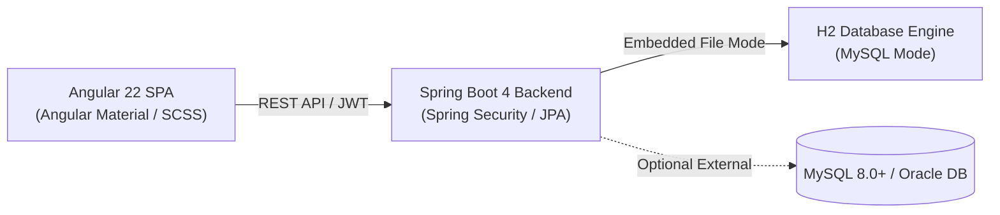

# OrderCraft: Manufacturing Order Management System (OMS)

[](https://ordercraft-7wto.onrender.com/)
[](https://spring.io/projects/spring-boot)
[](https://angular.dev/)
[](https://www.docker.com/)

**OrderCraft** is an enterprise-grade Manufacturing Order Management System (OMS) built with **Spring Boot 4 / Java 17+**, **Angular 22**, and **Spring Security (JWT)**. It streamlines the end-to-end manufacturing **Order-to-Cash (O2C)** operational lifecycle: from multi-item sales orders and automated Bill-of-Materials (BOM) inventory explosion to 1-click procurement, inventory synchronization, GST tax invoicing, and payment reconciliation.

🌐 **Live Deployed Application**: [https://ordercraft-7wto.onrender.com](https://ordercraft-7wto.onrender.com)

---

## 🌟 Key Highlights & Core Capabilities

1. **Sales Order Intake & Configuration**: Create customer orders with multiple line items, real-time subtotal/tax calculations, and status tracking (`PENDING`, `CONFIRMED`, `IN_PRODUCTION`, `INVOICED`, `PAID`, `CANCELLED`).
2. **Automated BOM Explosion & Shortage Detection**: Dynamically explodes product bills of materials against current warehouse inventory to detect exact raw material deficits in real-time.
3. **1-Click Purchase Order Generation**: Groups detected material shortages by primary vendor and automatically generates grouped Purchase Orders with realistic lead-time dates.
4. **Goods Receipt & Inventory Sync**: Receiving ordered goods immediately increments warehouse stock balances and satisfies outstanding production requirements.
5. **Corporate Tax Invoicing**: Generates GST invoices with configurable tax rates, payment due dates, and printable company letterheads.
6. **Payment Tracking & Settlement**: Records full and partial customer payments with transaction reference tracking, automatically transitioning orders to `PAID` upon full settlement.
7. **End-to-End Authentication & User Security**:
   - **Sign In**: Username/Email login with inline validation, error handling, password visibility toggle, and JWT Bearer token generation.
   - **Sign Up / Registration**: New user self-registration with password complexity rules (minimum 8 characters, letters & numbers), role selection (`Sales Specialist`, `Procurement Manager`, `Accounts Officer`), and duplicate conflict checks.
   - **User Profile & Change Password**: Unified user trigger button in navbar with role badge, interactive User Profile dialog, and modal Change Password flow with current password verification and BCrypt hashing.
8. **Role-Based Access Control (RBAC)**: Strict server-side route guards, navigation menu filtering, and action gating across `ADMIN`, `SALES`, `PURCHASE`, and `ACCOUNTS` personas.

---

## 👥 Default Demo Credentials

The database automatically seeds the following pre-configured credentials upon first launch:

| Role | Username | Password | Permitted Modules & Access Capabilities |
|---|---|---|---|
| **ADMIN** | `admin` | `Admin@123` | Complete system access: User Management, Reports, full O2C workflows |
| **SALES** | `sales` | `Sales@123` | Customers, Products & BOMs, Sales Orders creation, Invoice viewing |
| **PURCHASE** | `purchase` | `Purchase@123` | Suppliers, Raw Materials, Purchase Orders, Goods Receipt stock sync |
| **ACCOUNTS** | `accounts` | `Accounts@123` | Tax Invoice generation, Payment recording, Financial settlements |

*Note: You can also use the **Sign Up** tab on the login page to create custom accounts for any non-admin role, or switch roles using the demo switcher in development.*

---

## 🏗️ Architecture & Technology Stack



| Layer | Technologies & Standards |
|---|---|
| **Frontend** | Angular 22, TypeScript 6.0, Angular Material & CDK, RxJS 7.8, Modern CSS (Inter Font) |
| **Backend** | Java 17+, Spring Boot 4.1.1, Spring Data JPA, Spring Security 6, JJWT 0.12.6, Hibernate |
| **Database** | Embedded persistent H2 engine (MySQL/Oracle compatibility mode) with zero configuration; or external MySQL 8.0+ |
| **Containerization** | Multi-stage Dockerfile (`node:24-alpine` -> `maven:3.9-eclipse-temurin-17-alpine` -> `eclipse-temurin:17-jre-alpine`) |
| **Hosting** | Render Web Service (Single embedded full-stack container, dynamic `$PORT` routing) |

---

## 🚀 Deployment & Cloud Hosting

### Live Cloud Deployment
OrderCraft is deployed as a single self-contained container on Render:
- **Application URL**: [https://ordercraft-7wto.onrender.com](https://ordercraft-7wto.onrender.com)
- **Embedded Static SPA**: The Angular production build (`dist/ordercraft-frontend/browser`) is served directly by the Spring Boot JAR from `src/main/resources/static`.
- **H2 Persistent Storage**: Data persists in `./data/ordercraft.mv.db` inside the container or attached volume disk.

### Deploying Your Own Instance (Render / Railway / Docker)

1. **Fork or Clone this repository**:
   ```bash
   git clone https://github.com/ashishyadav024/OrderCraft.git
   cd OrderCraft
   ```

2. **Deploy on Render**:
   - Go to [dashboard.render.com](https://dashboard.render.com/) -> **New** -> **Web Service**.
   - Connect your GitHub repository: `OrderCraft`.
   - Select **Docker** as the Environment.
   - Leave the build and start commands blank (Render reads the `Dockerfile` automatically).
   - Click **Deploy Web Service**.

3. **Run via Docker Compose locally**:
   ```bash
   docker compose up -d --build
   ```
   Access the application at: `http://localhost:8085`

4. **Build Docker Image manually**:
   ```bash
   docker build -t ordercraft:latest .
   docker run -p 8085:8085 -v ordercraft_data:/app/data ordercraft:latest
   ```

---

## 💻 Local Development Setup

### Prerequisites
- **Node.js**: v24.x or v22.22+
- **Java JDK**: 17 or higher
- **Maven**: 3.9+ (or use the included `./mvnw`)

### 1. Run Spring Boot Backend
```bash
cd backend
./mvnw clean spring-boot:run
```
The backend starts at: `http://localhost:8085`
- H2 Web Console: `http://localhost:8085/h2-console` (JDBC URL: `jdbc:h2:file:./data/ordercraft`, User: `sa`, Password: *(empty)*)

### 2. Run Angular Frontend
```bash
cd ordercraft-frontend
npm install
npm start
```
The frontend starts at: `http://localhost:4200`
Requests to `/api/*` are reverse-proxied to `http://localhost:8085` via `proxy.conf.json`.

---

## 🔄 Complete O2C Workflow Walkthrough

1. **Sign in** as `admin` (or `sales`) at [https://ordercraft-7wto.onrender.com](https://ordercraft-7wto.onrender.com).
2. Go to **Sales Orders** (`/orders`) -> click **New Sales Order**. Pick a customer (e.g. *Tesla Motors India*), add products (e.g. *Industrial Gearbox*), and submit.
3. Open the order details: the **Bill of Materials (BOM)** component highlights inventory shortfalls in amber/red.
4. Click **Auto-Generate Purchase Orders**: grouped POs are automatically created for missing materials per supplier.
5. Switch to **Procurement** (`/purchase-orders`): open each PO and click **Receive Goods** to simulate supplier delivery. Raw materials stock is instantly replenished.
6. Return to the order and click **Generate Tax Invoice** to issue the GST bill.
7. Navigate to **Finance / Invoices** (`/invoices`) -> click **Record Payment** to settle invoice balances. The sales order status dynamically advances to `PAID`.

---

## 📄 License
This project is licensed under the MIT License.
